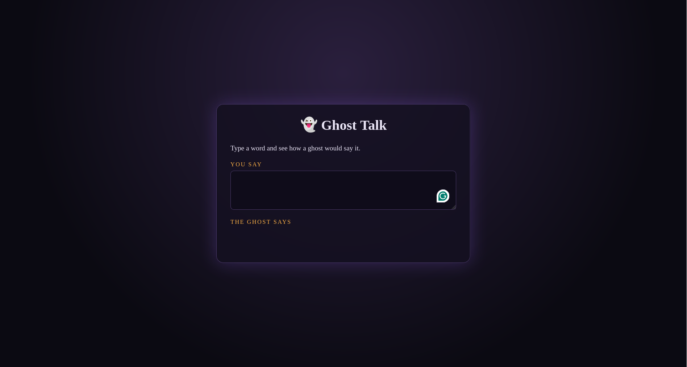

# Ghosty

A tiny JavaScript translator that turns ordinary words into "Ghost Talk" — a spooky Pig Latin variant.


[Live Preview](https://sparechange679.github.io/ghosty/)


Description
-----------
Ghosty converts words into "ghost talk":

- Words that start with a vowel get `-boo` added to the end (e.g., `owl` → `owl-boo`).
- Words that start with a consonant move the first letter to the end and add `-oo` (e.g., `candy` → `andy-coo`).
- Capitalization is preserved sensibly (e.g., `Candy` → `Andy-coo`).
- Punctuation is left in place.
- Apostrophes are handled correctly (remain part of the word).
- Translates every word in a sentence.
- Passes through things that aren't words (numbers, emojis, punctuation tokens).

Features
--------
- ✓ Words that start with a vowel get `-boo` added to the end  
- ✓ Words that start with a consonant move the first letter to the end and add `-oo`  
- ✓ Keeps capital letters sensible  
- ✓ Leaves punctuation in place  
- ✓ Handles apostrophes  
- ✓ Translates every word in a sentence  
- ✓ Passes through things that aren't words

Quick examples
--------------
- `owl` → `owl-boo`
- `candy` → `andy-coo`
- `Apple` → `Apple-boo`
- `Candy` → `Andy-coo`
- `Hello!` → `Ello-coo!`
- `don't` → `on'td-coo`
- `123` → `123` (unchanged)
- `Boo 👻` → `OoB-coo 👻`

Usage
-----
Open the demo HTML (or use the function from your JS) and pass a single word or a full sentence to translate.

Example JavaScript usage:
```javascript
// Example signature — replace with your implementation
// const ghostify = (text) => { /* returns translated text */ }

console.log(ghostify("owl")); // "owl-boo"
console.log(ghostify("candy")); // "andy-coo"
console.log(ghostify("Hello, world!")); // "Ello-coo, orld-woo!" (illustrative)
```

Implementation notes
--------------------
- A word is treated as a sequence of alphabetic characters possibly containing internal apostrophes. Leading/trailing punctuation is preserved.
- Capitalization of the original word's first letter is preserved on the transformed word (so proper nouns remain capitalized).
- Non-word tokens (numbers, emojis, purely punctuation tokens) are passed through unchanged.

Preview
-------
The preview above links to `screenshot.png` in the repository root. Replace or update that file to change what appears in this README.

Contributing
------------
Contributions, bug reports, and improvements are welcome. If you add tests, please include examples that cover:
- vowel-starting words
- consonant-starting words (including uppercase)
- words with punctuation (commas, periods, exclamation)
- words with apostrophes
- mixed sentences with non-word tokens

License
-------
MIT License — feel free to reuse and adapt.

Credits
-------
Created by sparechange679 — a fun CodePen challenge to make words a little spookier. 👻
